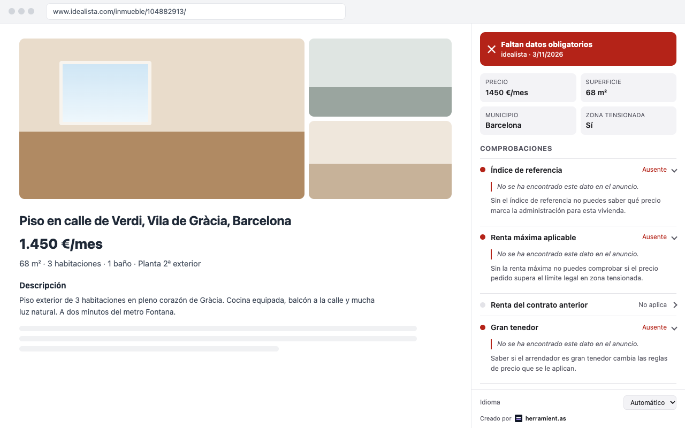
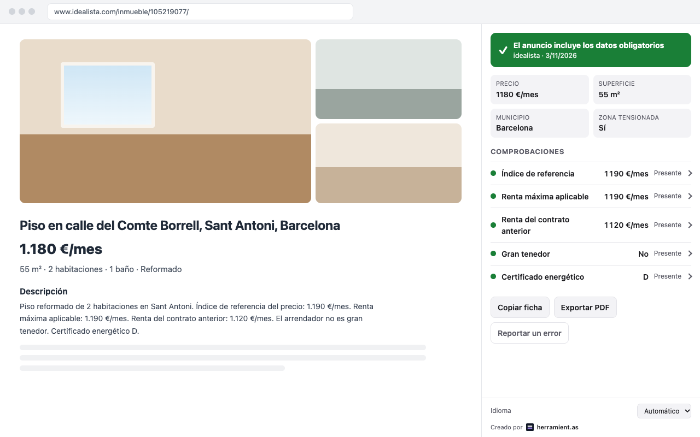
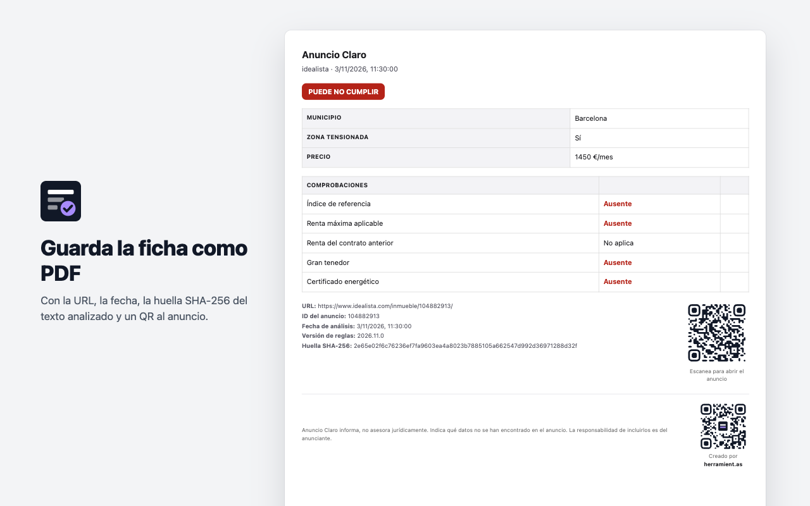

<p align="center">
  
</p>

<h1 align="center">Anuncio Claro</h1>

<p align="center">
  Does this rental listing include the information the law requires?<br>
  A browser extension that tells you at a glance.
</p>

<p align="center">
  
  
  
  
</p>

<p align="center">
  
</p>

Browser extension (Manifest V3, TypeScript) for **Chrome and Firefox** that reads a rental listing and checks
it against the art. 20 disclosure duties of
**[RDL 29/2026](https://www.boe.es/buscar/pdf/2026/BOE-A-2026-20823-consolidado.pdf)**:
reference price index, applicable maximum rent, large‑landlord status, energy
certificate and more. It shows a clear, exportable summary with a green / amber /
red verdict. Everything runs locally. No page text leaves the browser.

> It informs, it does not give legal advice. A missing field is reported as "no se
> ha encontrado este dato en el anuncio", attributing the omission to the ad, not
> the portal. Rule wording must be validated by a jurist before any public launch.

## Portals

Idealista, Fotocasa, Habitaclia, Pisos.com, Yaencontre and Milanuncios. Each has a
small adapter that reads the fields a portal hides in markup (price, municipality,
surface, energy grade). All share one pure, DOM‑free rules engine.

## Features

- The normalized summary (foldable per‑field evidence, EU‑style A–G energy scale)
  shown two ways from one renderer: an **in‑page panel** opened by the pill, and the
  browser's **side panel / sidebar** opened by the toolbar icon.
- In‑page pill and a toolbar badge (✓ / ! / ✕).
- Interface in **Español, Català, Euskara, Galego and English**, auto‑detected from
  the browser and overridable in the panel.
- Export: plain text, JSON (versioned schema), and an **evidence PDF** with the
  listing URL, a scannable QR, timestamp and a SHA‑256 of the analyzed text.
- One‑click "report an error" that pre‑fills an email with the listing's context.

| Everything in order | Evidence PDF |
| --- | --- |
|  |  |

## Install (from source)

```bash
npm install          # first run approves esbuild's postinstall
npm run build:all    # -> dist/ (Chrome) and dist-firefox/ (Firefox)
```

**Chrome**

1. Open `chrome://extensions`, enable **Developer mode**.
2. **Load unpacked** and select the `dist/` folder.
3. Open a rental listing on a supported portal. The badge and pill appear. Click
   either, or the toolbar icon, to open the side panel.

**Firefox**

1. Open `about:debugging#/runtime/this-firefox`.
2. **Load Temporary Add-on** and select `dist-firefox/manifest.json`.
3. Open a supported listing. Click the **pill** for the in‑page panel, or the
   **toolbar icon** to open the same ficha as a Firefox sidebar.

> The **pill opens an in‑page panel** (an overlay drawn on the page), which works
> identically on Chrome and Firefox. The **toolbar icon** opens the browser's own
> panel surface: Chrome's side panel, Firefox's sidebar. Firefox can only open
> that sidebar from the toolbar button (Gecko requires a direct user gesture),
> which is exactly why the pill uses the in‑page panel instead. Firefox builds
> target **121+** (module background + `storage.session`).

`npm run watch` (or `npm run watch:firefox`) rebuilds on change. Reload the
extension after editing `manifest.json`, `panel.html` or `panel.css`.

## Commands

| Command | What it does |
| --- | --- |
| `npm run build` | Bundle the Chrome extension into `dist/` |
| `npm run build:firefox` | Bundle the Firefox extension into `dist-firefox/` |
| `npm run build:all` | Build both targets |
| `npm run watch` | Rebuild the Chrome bundle on change |
| `npm test` | Vitest suite over the pure core |
| `npm run typecheck` | `tsc --noEmit`, strict |
| `npm run store-assets` | Rasterize the icons and render the store images into `store/` (needs Chrome, `rsvg-convert`, ImageMagick) |

## How it works

Pipeline: **detect → extract → interpret → evaluate → present** (PRD F1–F5).

```
src/
  adapters/      Per-portal DOM extraction -> pure assembly (build.ts) -> ExtractedListing
  rules/         Pure engine (engine.ts), amount normalization, versioned ruleset + stressed-zone table
  i18n/          Message catalogs (es/en/ca/eu/gl) + locale resolution
  export/        Plain-text and evidence-PDF (with QR) builders
  content/       Content script: extract, evaluate, paint pill + in-page panel (retries for SPA hydration)
  background/    Service worker: badge, per-tab cache, side panel / sidebar
  panel/         Side panel UI + ficha.ts (shared renderer for panel and overlay)
  platform.ts    Cross-browser shim: chrome/browser namespace + sidePanel/sidebar
schema/          Published JSON Schema (draft 2020-12)
```

Design notes:

- The **rules engine is pure** (`ExtractedListing` in, `ListingCheck` out). That is
  the auditable core, and where the tests point.
- **Rule content is versioned data** (keywords, legal citations, stressed‑zone
  table), separate from engine logic, so it can be updated without a code change.
- An unknown municipality resolves to `stressedZone: null`, never `false`, so a
  check never produces a false "cumple" where the table has no verdict.

## Privacy

No accounts, no server, no analytics, and no network requests. Analysis runs in
the browser. The result for each tab lives in `storage.session` and is dropped when
the tab closes; `storage.local` holds only the language preference. Host access is
limited to the six portal domains.

## Status and caveats

Pre‑launch. The stressed‑zone table is a seed sample and must be reconciled against
the official MIVAU / SERPAVI resolutions. Portal selectors are validated against
real listings but can drift when a portal changes its markup. See the open items in
the project notes.

## Brand assets

The mark is `public/icons/icon.svg` (manifest icons are rasterized from it) and the
lockup with "by herramient.as" is `docs/logo.svg`. `npm run store-assets` renders
the Chrome Web Store screenshots and promo tiles from the real panel and rules
engine, so they always show what the extension actually displays.

---

<p align="center">
  <a href="https://herramient.as"> Creado por <strong>herramient.as</strong></a>
</p>
